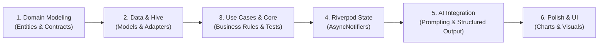

# AI Health Tracker: Architecture & Mental Model Blueprint

> Senior Engineering Guide: How to design and structure a production-grade Flutter application without falling into copy-paste traps.

---

## 1. The Senior Engineer's Mental Model: How to Think

A junior or "copy-paste" engineer starts by asking:
> *"What packages should I install, and where can I find sample code to copy?"*

A senior engineer starts by asking:
1. **What is the domain?** What are the core rules of health data that remain true whether this is a Flutter app, a CLI, or a backend service?
2. **Where do boundaries belong?** If we replace Hive with SQLite tomorrow, or replace Gemini API with a local model, how many files outside the data layer have to change? (The answer should be **zero**).
3. **What are the failure modes?** Health data can have corrupted sensor readings, missing permissions, network timeouts, or invalid biometric bounds (e.g., SpO2 > 100%). How is failure represented?

### The Core Architectural Principle: The Dependency Rule

```mermaid
flowchart TD
    subgraph Presentation ["Presentation Layer (Flutter, Riverpod)"]
        UI[UI Widgets & Screens]
        Notifiers[Riverpod AsyncNotifiers / Providers]
    end

    subgraph Domain ["Domain Layer (Pure Dart - Core Business Logic)"]
        UseCases[Use Cases / Interactors]
        Entities[Entities & Value Objects]
        RepoInterfaces[Repository Interfaces / Contracts]
    end

    subgraph Data ["Data Layer (Infrastructure & Adapters)"]
        RepoImpl[Repository Implementations]
        DataSources[Data Sources: Hive, HealthKit, AI Client]
        Models[Hive Models / DTOs / Mappers]
    end

    UI --> Notifiers
    Notifiers --> UseCases
    UseCases --> Entities
    UseCases --> RepoInterfaces
    RepoImpl --> RepoInterfaces
    RepoImpl --> DataSources
    RepoImpl --> Models
    Models -.->|Mappers: toDomain() / fromDomain()| Entities
```

**Golden Rules:**
- **Domain depends on nothing.** It does not import Flutter, Hive, or Riverpod.
- **Data depends on Domain** (implements Domain contracts).
- **Presentation depends on Domain** (calls Use Cases / reads Entities).
- **Presentation never communicates directly with Data.**

---

## 2. Domain Modeling (The Invariants & Entities)

Before any database or UI exists, define the core domain objects and their business rules.

### Metrics Breakdown

| Metric | Essential Fields | Business Invariants & Validations |
| :--- | :--- | :--- |
| **Steps** | `count`, `date`, `distanceKm`, `caloriesBurned` | `count >= 0`, `date <= now` |
| **Sleep** | `startTime`, `endTime`, `stages` (Deep, Light, REM, Awake), `qualityScore` | `endTime > startTime`, `qualityScore` clamped to 0–100 |
| **Blood Oxygen (SpO2)** | `percentage`, `timestamp` | `percentage` strictly between 50% and 100% (anything lower is sensor error or emergency) |
| **Blood Pressure** | `systolic`, `diastolic`, `pulse`, `timestamp` | `systolic > diastolic`, normal: `<120/<80`, stage 1: `130-139 / 80-89` |
| **AI Health Insight** | `id`, `generatedAt`, `summary`, `actionableRecommendations`, `riskLevel`, `disclaimer` | Must always contain a medical disclaimer (*"Not medical advice"*), must reference source metric IDs |

---

## 3. The 3 Biggest Anti-Patterns to Avoid

### ❌ Anti-Pattern 1: Putting `@HiveType` Directly on Domain Entities
```dart
// WRONG: Pollutes the domain layer with a specific persistence library
@HiveType(typeId: 0)
class BloodPressure {
  @HiveField(0) final int systolic;
  @HiveField(1) final int diastolic;
}
```
**Why it fails:** If you decide to encrypt data, migrate to SQLite, or run pure unit tests, your domain is tied to Hive's build runners and adapters.  
**Senior Solution:** Keep `BloodPressure` as a pure Dart class in `domain/entities/`. Create `BloodPressureHiveModel` in `data/models/` with explicit `.toDomain()` and `.fromDomain()` mapping.

---

### ❌ Anti-Pattern 2: Letting Riverpod Providers Call Hive or APIs Directly
```dart
// WRONG: Bypasses domain logic and tightly couples UI state to Hive
final bpProvider = FutureProvider((ref) async {
  final box = await Hive.openBox('bp');
  return box.values.toList();
});
```
**Why it fails:** Business rules (sorting, filtering anomalies, error transformations) get smeared across UI providers, making them impossible to test or reuse.  
**Senior Solution:** Riverpod calls a **Use Case** or **Repository Contract**. The provider does not know Hive even exists.

---

### ❌ Anti-Pattern 3: Treating AI Output as Raw Text in the UI
```dart
// WRONG: Dumping raw LLM markdown into the widget
Text(aiResponseString);
```
**Why it fails:** AI output can hallucinate, omit critical health disclaimers, or return irregular formatting that breaks layouts.  
**Senior Solution:** Force the AI to output structured JSON conforming to a domain schema (`HealthInsight`), validate it with a parser, and display typed widgets (e.g. key findings, action cards, confidence tags).

---

## 4. Proposed Modular Folder Structure

```
lib/
├── app/
│   ├── app.dart                   # MaterialApp, routing, theme
│   └── observer.dart              # Riverpod state observer for debugging
├── core/
│   ├── errors/
│   │   ├── exceptions.dart        # Data-level exceptions
│   │   └── failures.dart          # Domain-level failure types (Result/Either)
│   ├── constants/                 # Medical standard thresholds & strings
│   ├── services/                  # Platform, secure storage, sensors
│   └── utils/                     # Date formatters, math utilities
├── features/
│   ├── health_tracking/
│   │   ├── domain/
│   │   │   ├── entities/          # BloodPressure, StepCount, SleepRecord, SpO2
│   │   │   ├── repositories/      # HealthMetricsRepository (interface)
│   │   │   └── usecases/          # LogBloodPressure, GetDailyMetrics, etc.
│   │   ├── data/
│   │   │   ├── models/            # Hive models & mappers
│   │   │   ├── datasources/       # Local Hive data source, HealthKit/Connect source
│   │   │   └── repositories/      # HealthMetricsRepositoryImpl
│   │   └── presentation/
│   │   │   ├── controllers/       # Riverpod AsyncNotifiers (e.g., DashboardNotifier)
│   │   │   ├── widgets/           # Metric cards, metric input sheets, charts
│   │   │   └── views/             # DashboardScreen, MetricDetailScreen
│   └── ai_insights/
│       ├── domain/
│       │   ├── entities/          # HealthInsight, Recommendation, RiskLevel
│       │   ├── repositories/      # AiInsightRepository (interface)
│       │   └── usecases/          # GenerateDailyHealthInsight, AskAiHealthQuestion
│       ├── data/
│       │   ├── datasources/       # Gemini / LLM client
│       │   ├── models/            # Prompt templates, DTOs, JSON parsers
│       │   └── repositories/      # AiInsightRepositoryImpl
│       └── presentation/
│           ├── controllers/       # AiInsightNotifier
│           ├── widgets/           # InsightCard, RecommendationList, DisclaimerBadge
│           └── views/             # InsightScreen
└── main.dart                      # Hive setup, ProviderScope initialization
```

---

## 5. Development Roadmap: Step-by-Step


