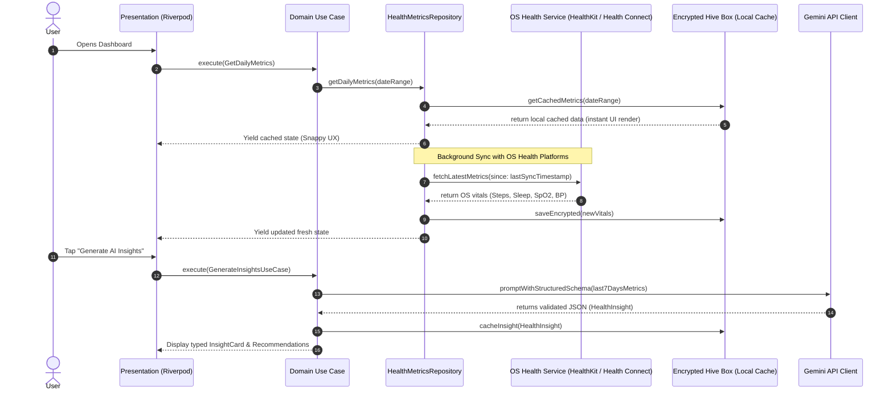
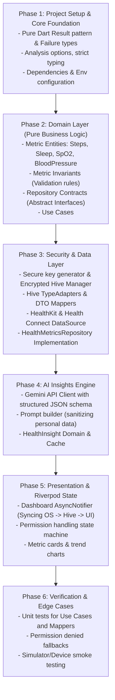

# AI Health Tracker: Production Implementation Roadmap

> Tailored for: **Apple HealthKit & Android Health Connect** + **Encrypted Hive** + **Gemini API** + **Clean Architecture with Riverpod**.

---

## 1. Architectural Strategy: The Offline-First Sync Pattern

Because you chose direct OS Health integration, you are building a real production-grade health system. Here is how a senior engineer conceptualizes the data flow:

---

## 2. Core Dependencies Strategy

| Capability | Package | Architectural Role | Why this choice? |
| :--- | :--- | :--- | :--- |
| **State Management** | `flutter_riverpod` | Presentation Layer | Unidirectional data flow, compile-safe DI, testable notifiers. |
| **Local Database** | `hive_flutter`, `hive` | Data Layer Cache | Fast key-value binary storage with zero native SQL overhead. |
| **Key Management** | `flutter_secure_storage` | Security Infrastructure | Hardware-backed keystore/keychain for the 256-bit Hive encryption key. |
| **Health Sensors** | `health` | Platform Data Source | Unified cross-platform abstraction over Apple HealthKit and Android Health Connect. |
| **AI Intelligence** | `google_generative_ai` | AI Data Source | Official Google SDK with `responseSchema` support for guaranteed JSON output. |
| **Error Handling** | Pure Dart 3 Sealed Classes | Core / Domain | `Result<T, Failure>` pattern without heavy external dependencies. |

---

## 3. The 6-Phase Engineering Roadmap

---

## 4. Phase-by-Phase Checklist & Deliverables

### Phase 1: Core Foundation & Strict Setup
- [ ] Configure `pubspec.yaml` with production-pinned dependencies.
- [ ] Create `lib/core/errors/failures.dart` using modern Dart 3 `sealed class Result<S, F>`.
- [ ] Set up secure environment config (`.env` or `--dart-define` for Gemini API Key).
- [ ] Configure Android Health Connect manifest permissions & iOS `Info.plist` HealthKit privacy strings.

### Phase 2: Domain Layer (Zero Dependencies)
- [ ] Define `StepMetric`, `SleepMetric`, `BloodOxygenMetric`, and `BloodPressureMetric`.
- [ ] Implement domain invariants (e.g., Blood Pressure systolic must exceed diastolic; SpO2 within 50–100%).
- [ ] Define `HealthMetricsRepository` abstract interface.
- [ ] Define `AiInsightRepository` abstract interface.
- [ ] Create Use Cases: `GetDailyMetricsUseCase`, `SyncHealthDataUseCase`, `GenerateHealthInsightUseCase`.

### Phase 3: Data & Security Layer
- [ ] Implement `SecureStorageService` to retrieve or generate a random 256-bit Hive encryption key.
- [ ] Implement `HiveDatabaseService` with encrypted boxes for metrics and insights.
- [ ] Create Hive DTOs (`BloodPressureHiveModel`, etc.) and register TypeAdapters.
- [ ] Implement `HealthPlatformDataSource` utilizing the `health` package for Apple HealthKit and Android Health Connect permissions and queries.
- [ ] Implement `HealthMetricsRepositoryImpl` marrying Hive local storage with OS sync.

### Phase 4: Gemini AI Integration
- [ ] Define the JSON output schema (`GeminiSchema`) ensuring the model returns strictly typed data.
- [ ] Implement `GeminiAiDataSource` with temperature tuning and health context prompt formatting.
- [ ] Enforce non-diagnostic disclaimers in the domain entity validation.

### Phase 5: Presentation Layer (Riverpod)
- [ ] Set up `ProviderScope` and Riverpod observers.
- [ ] Build `HealthDashboardNotifier` (`AsyncNotifier<HealthDashboardState>`).
- [ ] Build UI widgets:
  - Metric summary cards with live status (Normal, Elevated, Caution).
  - HealthKit / Health Connect authorization banner if permissions are pending.
  - AI Insights interactive card with collapsible medical suggestions.

### Phase 6: Testing & Quality Assurance
- [ ] Unit test Domain Use Cases with mock repositories.
- [ ] Unit test Hive DTO mappers (`toDomain()` and `fromDomain()`).
- [ ] Test offline behavior (verifying encrypted Hive loads when device has no internet).
