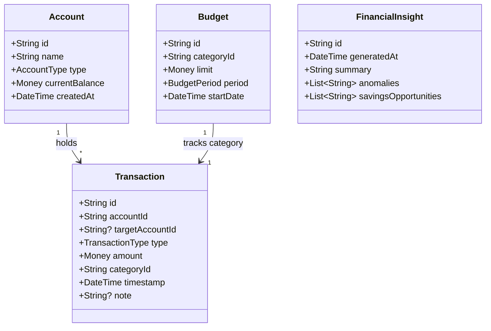

# Finance Tracker: Architecture & Mental Model Blueprint

> Senior Engineering Guide: How to design and structure a financial system without falling into rounding errors, data corruption, or copy-paste traps.

---

## 1. The Senior Financial Engineer's Mental Model

When transitioning from a Health App to a Financial App, your core engineering mindset must adapt to entirely new domain laws.

| Concept | Health Tracker App | Money Management / Finance App |
| :--- | :--- | :--- |
| **Data Nature** | Time-series biometric samples (steps, SpO2) | Strict transactional ledgers (every cent must balance) |
| **Tolerable Error** | Approximate estimations (e.g. ±50 steps is acceptable) | **Zero tolerance** for rounding errors ($0.01 discrepancy breaks trust) |
| **Number Type** | `double` / `int` (e.g., 98.6% SpO2, 120 mmHg) | **NEVER `double`**. Use integer minor units (cents) or arbitrary-precision `Decimal` |
| **Primary Invariant** | Biological validity (e.g. systolic > diastolic) | Accounting equation: `Assets = Liabilities + Equity` or `Balance = Incomes - Expenses` |
| **AI Role** | Health risk detection & habit coaching | Expense categorization, budget anomaly alerts, and cash-flow forecasting |

---

## 2. The #1 Cardinal Rule of Financial Software: Never Use `double`

A junior developer writes:
```dart
// ❌ DANGEROUS: Floating-point precision error
double balance = 100.0;
balance -= 0.1;
balance -= 0.2;
print(balance); // Prints 99.70000000000002!
```
Floating-point arithmetic in computers uses IEEE 754 binary fractions. Certain decimal numbers cannot be represented accurately in binary. Over hundreds of transactions, your user's balance will develop "phantom cents".

### The Senior Engineer's Value Object: `Money`
Store all monetary amounts as **integer minor units** (e.g., cents, pence, paise):
- \$10.50 is stored as `1050`
- \$0.05 is stored as `5`

```dart
// ✅ PURE DOMAIN VALUE OBJECT (lib/features/transactions/domain/entities/money.dart)
class Money {
  final int amountInCents; // e.g. 1050 for $10.50
  final String currency;   // ISO 4217, e.g. 'USD', 'EUR', 'BDT'

  const Money({required this.amountInCents, this.currency = 'USD'});

  factory Money.fromMajor(double amount, {String currency = 'USD'}) {
    return Money(
      amountInCents: (amount * 100).round(),
      currency: currency,
    );
  }

  double toMajor() => amountInCents / 100.0;

  Money operator +(Money other) {
    _assertSameCurrency(other);
    return Money(amountInCents: amountInCents + other.amountInCents, currency: currency);
  }

  Money operator -(Money other) {
    _assertSameCurrency(other);
    return Money(amountInCents: amountInCents - other.amountInCents, currency: currency);
  }

  void _assertSameCurrency(Money other) {
    if (currency != other.currency) {
      throw ArgumentError('Cannot operate on different currencies: $currency and ${other.currency}');
    }
  }
}
```

---

## 3. Financial Domain Invariants & Entities

### Core Entities



### Domain Invariants (Rules That Can Never Be Violated)
1. **Transfer Invariant**: A transfer between Account A and Account B must atomically decrease Account A's balance and increase Account B's balance by the exact same amount.
2. **Non-negative Budget Limit**: A budget limit cannot be zero or negative (`limit.amountInCents > 0`).
3. **Transaction Date Constraint**: Transactions cannot have timestamps placed unrealistically far into the future without being explicitly tagged as `scheduled`.
4. **Currency Matching**: Transactions assigned to an account must match the account's base currency.

---

## 4. The 4 Anti-Patterns to Avoid in Finance Apps

### ❌ Anti-Pattern 1: Storing Account Balances as Raw Mutable Fields Without a Ledger
- **The Mistake**: Just storing `account.balance = 500` and updating it directly whenever money is spent.
- **Why it Fails**: If a bug occurs, or an edit is made, you cannot reconstruct *why* the balance is \$500.
- **Senior Solution**: Calculate balance as an aggregation of transaction history (`InitialBalance + sum(Incomes) - sum(Expenses)`), or store periodic snapshot checkpoints with an audit ledger.

### ❌ Anti-Pattern 2: Hardcoding Currency Symbols in the UI
- **The Mistake**: Writing `Text('\$${transaction.amount}')` throughout widgets.
- **Why it Fails**: It breaks internationalization and multi-currency accounts immediately.
- **Senior Solution**: Use an internationalized formatter (e.g. `NumberFormat.simpleCurrency(name: currency).format(money.toMajor())`).

### ❌ Anti-Pattern 3: Unencrypted Storage for Financial Logs
- **The Mistake**: Saving bank names, balances, and expense descriptions in plain, unencrypted shared preferences or default Hive boxes.
- **Why it Fails**: Rooted Android devices or backup extractors can read full user financial history.
- **Senior Solution**: Always use AES-256 encrypted Hive boxes with keys stored in `flutter_secure_storage`.

### ❌ Anti-Pattern 4: Direct Unconstrained AI Prompts for Financial Advice
- **The Mistake**: Sending unformatted user data to an LLM and displaying raw text advice ("Invest all in crypto").
- **Why it Fails**: Severe liability, hallucinations, and unformatted UI layouts.
- **Senior Solution**: Enforce structured JSON schemas, include clear non-fiduciary disclaimers (*"For informational purposes only, not certified financial advice"*), and constrain the prompt to expense classification and spending pattern summaries.
