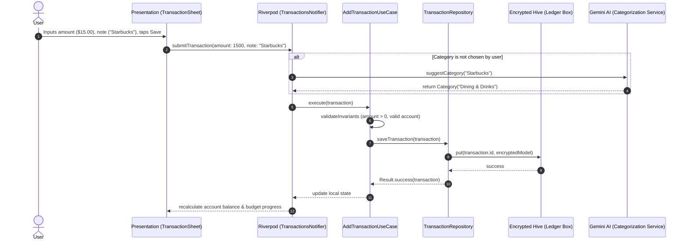
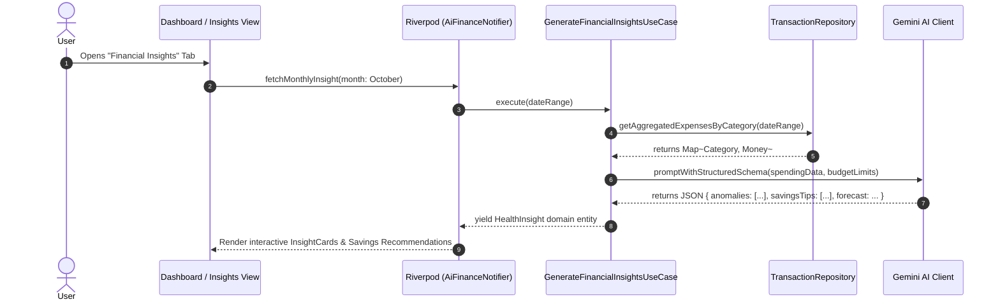
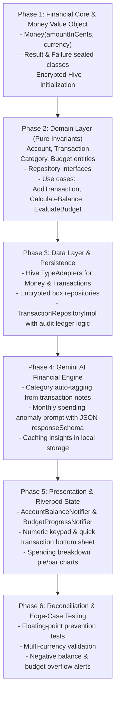

# Finance Tracker: Production Implementation Roadmap

> Tailored for: **Offline-First Encrypted Hive** + **Clean Architecture** + **Riverpod** + **Gemini AI Financial Coach**.

---

## 1. System Architecture & Data Flow

### Flow 1: Transaction Creation & Instant Ledger Reconciliation



### Flow 2: AI Monthly Spending & Budget Anomaly Analysis



---

## 2. Modular Folder Structure for Finance App

```
lib/
├── app/
│   ├── app.dart                   # MaterialApp, Theme (Currency locale, dark mode)
│   └── router.dart                # App navigation
├── core/
│   ├── errors/
│   │   ├── exceptions.dart        # Database / IO exceptions
│   │   └── failures.dart          # Pure Dart Result<S, F>
│   ├── security/
│   │   └── secure_key_manager.dart# AES-256 key generation via flutter_secure_storage
│   └── utils/
│       ├── currency_formatter.dart# Locale-aware formatting (Intl)
│       └── date_helpers.dart      # Billing cycles, start of month, week ranges
├── features/
│   ├── accounts/                  # Wallets / Bank / Cash accounts
│   │   ├── domain/                # Account entity, AccountRepository
│   │   ├── data/                  # AccountHiveModel, AccountRepositoryImpl
│   │   └── presentation/          # AccountCard, AccountsNotifier
│   ├── transactions/              # Ledger & Logging
│   │   ├── domain/
│   │   │   ├── entities/          # Money (Value Object), Transaction, Category
│   │   │   ├── repositories/      # TransactionRepository (interface)
│   │   │   └── usecases/          # AddTransaction, GetRecentTransactions, GetCategorySummary
│   │   ├── data/
│   │   │   ├── models/            # TransactionHiveModel, Mappers
│   │   │   ├── datasources/       # LocalEncryptedTransactionDataSource
│   │   │   └── repositories/      # TransactionRepositoryImpl
│   │   └── presentation/
│   │       ├── controllers/       # TransactionsNotifier (AsyncNotifier)
│   │       ├── widgets/           # TransactionTile, AmountKeypad, CategoryPicker
│   │       └── views/             # TransactionHistoryScreen, AddTransactionModal
│   ├── budgets/                   # Budget tracking & limits
│   │   ├── domain/                # Budget entity, EvaluateBudgetStatusUseCase
│   │   ├── data/                  # BudgetHiveModel, BudgetRepositoryImpl
│   │   └── presentation/          # BudgetProgressBar, BudgetsScreen
│   └── ai_coach/                  # Gemini AI Financial Advisor
│       ├── domain/
│       │   ├── entities/          # FinancialInsight, SpendingAnomaly, AdviceItem
│       │   ├── repositories/      # AiCoachRepository (interface)
│       │   └── usecases/          # GenerateMonthlyInsightsUseCase, CategorizeNoteUseCase
│       ├── data/
│       │   ├── datasources/       # GeminiFinancialClient (structured JSON schema)
│       │   └── repositories/      # AiCoachRepositoryImpl
│       └── presentation/
│           ├── controllers/       # AiCoachNotifier
│           └── widgets/           # AnomalyAlertCard, AdviceRecommendationCard
└── main.dart
```

---

## 3. The 6-Phase Engineering Roadmap



---

## 4. Phase-by-Phase Checklist & Deliverables

### Phase 1: Financial Core Foundation
- [ ] Implement `Money` value object (`amountInCents`, currency matching, safe math operators).
- [ ] Implement `Result<S, F>` sealed class with exhaustive pattern matching.
- [ ] Configure `flutter_secure_storage` to generate and persist a 256-bit AES encryption key.
- [ ] Initialize Hive with the encrypted cipher box.

### Phase 2: Domain Layer (Zero Dependencies)
- [ ] Define `Account` entity (id, name, type: cash/bank/credit, balance).
- [ ] Define `Transaction` entity (id, accountId, type: expense/income/transfer, amount, category, date).
- [ ] Define `Budget` entity (categoryId, limit, period: weekly/monthly).
- [ ] Define abstract `TransactionRepository`, `AccountRepository`, `BudgetRepository`.
- [ ] Implement `AddTransactionUseCase`, `GetAccountBalanceUseCase`, and `CheckBudgetExceededUseCase`.

### Phase 3: Data Layer & Encryption
- [ ] Write `TransactionHiveModel` with explicit Hive field indices.
- [ ] Implement `toDomain()` and `fromDomain()` mapping functions (handling cents conversion cleanly).
- [ ] Implement `LocalTransactionDataSource` storing encrypted records.
- [ ] Write unit tests verifying that balance calculation matches the sum of ledger transactions.

### Phase 4: Gemini AI Financial Coach
- [ ] Define Gemini JSON Schema for `FinancialInsight`:
  - `summary`: string
  - `anomalies`: list of category spikes
  - `actionableTips`: list of concrete savings actions
  - `disclaimer`: required non-fiduciary statement
- [ ] Implement `GeminiAiCoachDataSource` using `google_generative_ai`.
- [ ] Build a categorization heuristic: prompt Gemini to infer category from unstructured merchant notes (e.g. "Uber 0842" -> "Transportation").

### Phase 5: Presentation Layer (Riverpod)
- [ ] Implement `AccountsNotifier` providing live balance streams.
- [ ] Implement `BudgetsNotifier` tracking percentage spent against limits.
- [ ] Build a custom transaction input sheet with a clean number keypad (typing \$15.00 directly into cents).
- [ ] Build visual category indicators with progress bars (Green -> Amber -> Red when over 90% budget).

### Phase 6: Edge Cases & Verification
- [ ] Test round-trip conversions (making sure 100 iterations of +$0.10 never yields $9.999999).
- [ ] Test atomic transfers (ensuring transfer failure rolls back both accounts).
- [ ] Test offline behavior (logging transactions without internet, queuing AI categorization when online).
