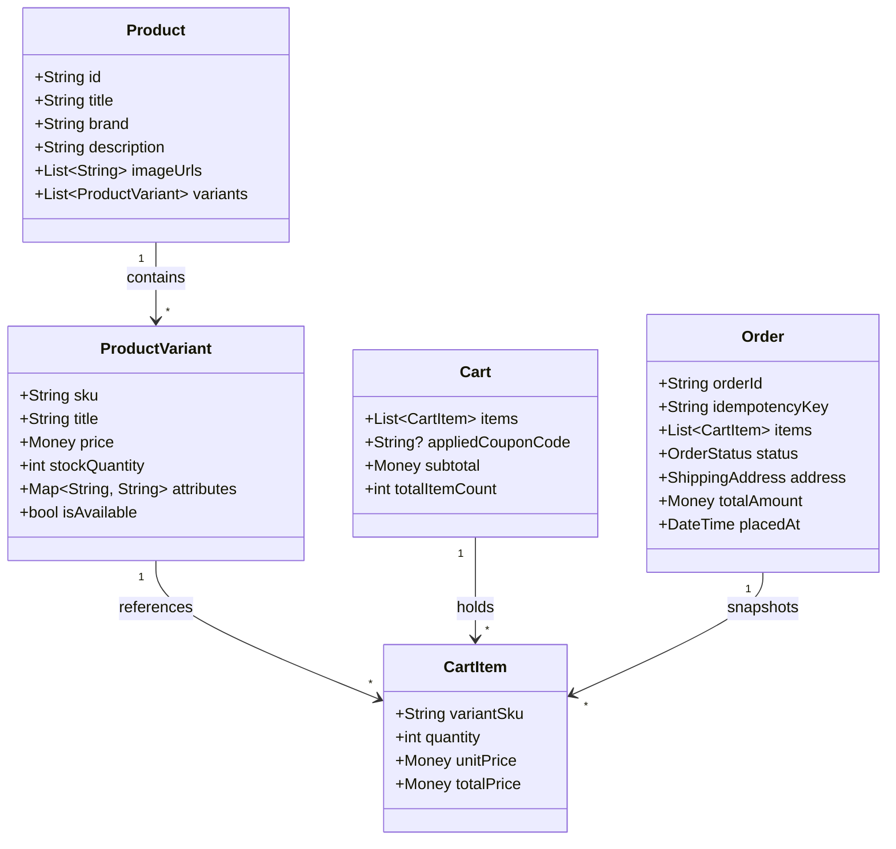

# E-Commerce App: Architecture & Mental Model Blueprint

> Senior Engineering Guide: How to structure an enterprise-ready shopping application, manage inventory volatility, design checkout state machines, and avoid copy-paste architecture traps.

---

## 1. The Senior E-Commerce Engineer's Mental Model

Transitioning from Health and Finance to E-Commerce introduces a completely new set of engineering challenges: **network concurrency, inventory volatility, and distributed state.**

| Dimension | Health Tracker App | Money Management App | E-Commerce App |
| :--- | :--- | :--- | :--- |
| **Primary Challenge** | Sensor data streams & OS permissions | Ledger reconciliation & rounding precision | **Inventory race conditions & network caching** |
| **Data Authority** | Client-authoritative (Device sensors/Hive) | Client-authoritative (User's private ledger) | **Server-authoritative** (Backend dictates stock & price) |
| **Cache Strategy** | Offline-first sync | Offline-first encrypted ledger | **Stale-While-Revalidate** (Catalog) + **Local/Remote Sync** (Cart) |
| **Critical Failure** | Sensor data loss / permission denial | Math error / phantom cents | **Double charges / ordering out-of-stock items** |
| **AI Role** | Health habit insights & metric alerts | Expense categorization & anomaly alerts | **Semantic product discovery, visual search & personal styling** |

---

## 2. Core Architectural Principles of E-Commerce

### 1. Client Proposes, Server Disposes (Never Trust the Client for Prices)
A junior developer calculates cart totals in Flutter and sends:
```json
// ❌ CRITICAL SECURITY VULNERABILITY
{ "orderId": "123", "totalToCharge": 49.99 }
```
A malicious user can intercept the HTTP payload and change `49.99` to `0.01`.
- **Senior Rule**: The client only sends `[{ "sku": "SHOES-RED-42", "quantity": 1 }]`. The server (or backend use case) re-fetches the current product prices from database authority, calculates taxes, applies valid coupons, and charges the authenticated amount.

### 2. Product vs. Product Variant (The SKU Problem)
Users do not buy a "T-Shirt". They buy a "T-Shirt, Color: Black, Size: Medium".
- A **Product** is a marketing container (Title, Description, Images, Category).
- A **ProductVariant (SKU)** is the physical inventory unit (Stock quantity, specific barcode, weight, variant price).
- If your domain model conflates `Product` with `CartItem`, you will break inventory tracking.

### 3. Idempotency in Checkout
If a user taps "Pay Now" on a 3G connection and the network times out:
- Did the payment go through?
- If they tap "Pay Now" again, will they get charged twice?
- **Senior Rule**: Every checkout attempt must generate a unique `Idempotency-Key` (UUIDv4) passed through the use case. Even if the request is resent 5 times, the payment gateway processes it exactly once.

---

## 3. Domain Modeling: Entities & Value Objects



### Domain Invariants (Unbreakable Business Rules)
1. **Stock Limit Invariant**: `CartItem.quantity` can never exceed `ProductVariant.stockQuantity`.
2. **Positive Quantity**: Cart item quantity must be $\ge 1$. An update to `0` automatically triggers removal.
3. **Price Snapshot**: When an `Order` is finalized, it snapshots the exact `unitPrice` at the time of purchase. Future price changes to the product must never modify historical order receipts.
4. **Checkout State Machine**: An order cannot transition directly from `Pending` to `Delivered` without passing through `Paid` and `Shipped`.

---

## 4. The 4 Anti-Patterns to Avoid in E-Commerce Apps

### ❌ Anti-Pattern 1: Ephemeral In-Memory Cart State
- **The Mistake**: Keeping the user's cart in a transient Riverpod `StateProvider` without local Hive persistence.
- **Why it Fails**: If the app is sent to the background and the OS kills the process to free RAM, the user returns to an empty cart and abandons the purchase.
- **Senior Solution**: Cart modifications immediately persist to a local Hive box (`CartHiveModel`), and optionally debounce sync to the user's cloud account if authenticated.

### ❌ Anti-Pattern 2: Infinite Scroll Memory Leaks
- **The Mistake**: Loading 500 high-resolution product images in a single `ListView` or `GridView` without pagination or memory eviction.
- **Why it Fails**: Out-Of-Memory (OOM) crash on lower-end Android devices.
- **Senior Solution**: Use Cursor-based pagination in the `ProductRepository`, combine with `cached_network_image` using bounded memory disk cache sizes and downsampled thumbnail URLs.

### ❌ Anti-Pattern 3: Bypassing the Checkout State Machine
- **The Mistake**: Firing off a payment request directly from a button click inside the cart screen.
- **Why it Fails**: What if inventory changed while the user was staring at the cart? What about address validation and tax calculation?
- **Senior Solution**: A formal `CheckoutFlowState` (ReviewCart $\to$ ValidateStock $\to$ SelectAddress $\to$ CalculateTaxes $\to$ AuthorizePayment $\to$ OrderConfirmed).

### ❌ Anti-Pattern 4: Raw LLM Search Without Catalog Grounding
- **The Mistake**: Asking Gemini: *"Recommend some shoes for running in rain"* without giving it your actual in-stock catalog.
- **Why it Fails**: Gemini will recommend a Nike shoe that your store does not sell or has out of stock.
- **Senior Solution**: Use **Retrieval-Augmented Generation (RAG)** or structured attribute filtering: Gemini extracts search filters (`category: shoes`, `feature: waterproof`), which are executed against your actual product catalog database.
