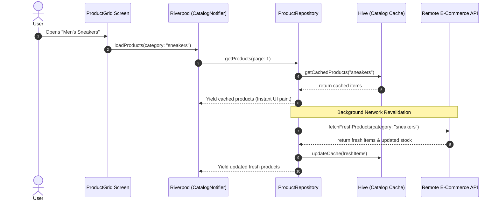
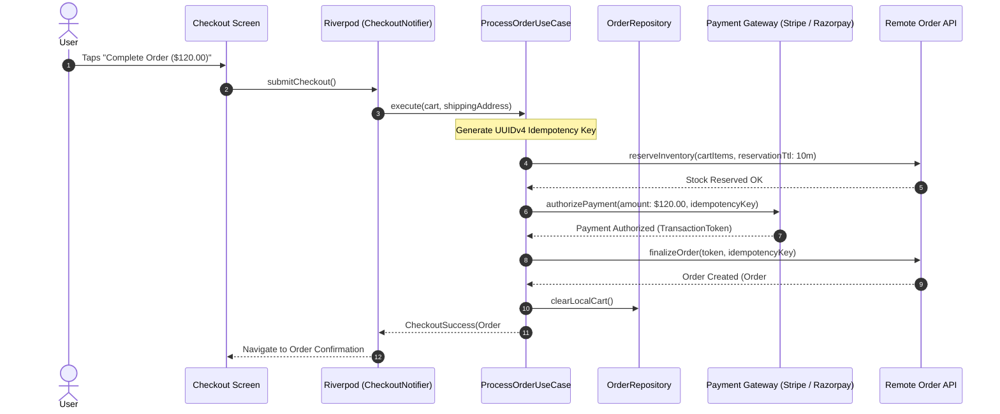
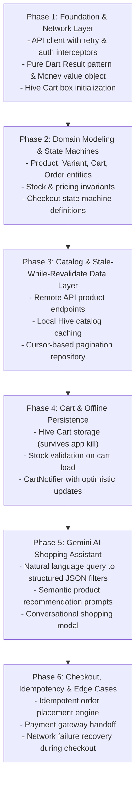

# E-Commerce App: Production Implementation Roadmap

> Tailored for: **Clean Architecture** + **Riverpod** + **Hive Cart Persistence** + **Gemini AI Shopping Assistant**.

---

## 1. System Architecture & Data Flow

### Flow 1: Stale-While-Revalidate Catalog Browsing & Cart Sync



### Flow 2: The Idempotent Checkout State Machine



---

## 2. Modular Folder Structure for E-Commerce

```
lib/
├── app/
│   ├── app.dart                   # MaterialApp, routing, global theme
│   └── router.dart                # Deep links (product/:id, order/:id)
├── core/
│   ├── errors/
│   │   ├── exceptions.dart        # ServerException, OutOfStockException
│   │   └── failures.dart          # Result<S, F> sealed classes
│   ├── network/
│   │   ├── api_client.dart        # Dio/Http client with interceptors
│   │   └── network_info.dart      # Connectivity checker
│   └── utils/
│       ├── currency_formatter.dart# Currency formatting using Intl
│       └── idempotency.dart       # Unique transaction key generator
├── features/
│   ├── catalog/                   # Products, Categories, Search
│   │   ├── domain/
│   │   │   ├── entities/          # Product, ProductVariant, SKU, Category
│   │   │   ├── repositories/      # ProductRepository (interface)
│   │   │   └── usecases/          # GetProductsByCategory, SearchProducts
│   │   ├── data/
│   │   │   ├── models/            # ProductModel, VariantModel (JSON DTOs)
│   │   │   ├── datasources/       # RemoteCatalogDataSource, LocalCatalogCache
│   │   │   └── repositories/      # ProductRepositoryImpl (Stale-While-Revalidate)
│   │   └── presentation/
│   │       ├── controllers/       # CatalogNotifier (Paging AsyncNotifier)
│   │       ├── widgets/           # ProductCard, VariantSelector, FilterBottomSheet
│   │       └── views/             # ProductListScreen, ProductDetailScreen
│   ├── cart/                      # Shopping Bag & Quantity
│   │   ├── domain/
│   │   │   ├── entities/          # Cart, CartItem
│   │   │   ├── repositories/      # CartRepository (interface)
│   │   │   └── usecases/          # AddToCart, UpdateQuantity, SyncCartWithStock
│   │   ├── data/
│   │   │   ├── models/            # CartHiveModel, CartItemHiveModel
│   │   │   └── repositories/      # CartRepositoryImpl (Local Hive + Remote sync)
│   │   └── presentation/
│   │       ├── controllers/       # CartNotifier (AsyncNotifier)
│   │       ├── widgets/           # CartItemTile, OrderSummaryCard
│   │       └── views/             # CartScreen
│   ├── checkout/                  # Shipping, Payment, Order State Machine
│   │   ├── domain/
│   │   │   ├── entities/          # Order, ShippingAddress, PaymentMethod
│   │   │   ├── repositories/      # CheckoutRepository (interface)
│   │   │   └── usecases/          # PlaceOrderUseCase, ValidateCouponUseCase
│   │   ├── data/
│   │   │   └── repositories/      # CheckoutRepositoryImpl
│   │   └── presentation/
│   │       ├── controllers/       # CheckoutFlowNotifier (State Machine)
│   │       └── views/             # CheckoutStepperScreen, OrderSuccessScreen
│   └── ai_shopping_assistant/     # Gemini Powered Personal Shopper
│       ├── domain/
│       │   ├── entities/          # SearchIntent, StylingRecommendation
│       │   └── usecases/          # ExtractSearchFiltersFromPromptUseCase
│       ├── data/
│       │   └── datasources/       # GeminiShoppingAssistantDataSource
│       └── presentation/
│           ├── controllers/       # AiAssistantNotifier
│           └── widgets/           # AiChatBottomSheet, SmartFilterChip
└── main.dart
```

---

## 3. The 6-Phase Engineering Roadmap



---

## 4. Phase-by-Phase Checklist & Deliverables

### Phase 1: Foundation & Infrastructure
- [ ] Implement `Result<S, F>` sealed class with `ServerFailure`, `StockFailure`, `NetworkFailure`.
- [ ] Configure `dio` or HTTP client with timeout, authentication headers, and network retry policy.
- [ ] Initialize Hive for persisting offline cart items and recent searches.

### Phase 2: Domain Layer (Zero Dependencies)
- [ ] Model `Product` and `ProductVariant` separating marketing metadata from inventory SKUs.
- [ ] Model `CartItem` ensuring quantity $> 0$ and clamping against maximum available stock.
- [ ] Model `CheckoutState` sealed class:
  - `CartReviewState`
  - `AddressSelectionState`
  - `PaymentProcessingState(idempotencyKey)`
  - `OrderCompletedState(order)`
  - `CheckoutFailedState(failure)`
- [ ] Define abstract `ProductRepository`, `CartRepository`, `CheckoutRepository`.

### Phase 3: Catalog Data Layer & Stale-While-Revalidate
- [ ] Build `ProductRepositoryImpl` that serves cached products instantly while revalidating via API in the background.
- [ ] Implement pagination (cursor or page-based) to prevent excessive memory consumption.
- [ ] Ensure image widgets utilize disk-cached network images with explicit width/height constraints.

### Phase 4: Cart Persistence & Stock Validation
- [ ] Register `CartHiveModel` TypeAdapter.
- [ ] Build `CartNotifier` using Riverpod `AsyncNotifier`:
  - Optimistic UI update: when the user taps "+", increase quantity immediately in UI and Hive, then validate with server.
  - If server reports out of stock, roll back the local change and show a snackbar.

### Phase 5: Gemini AI Shopping Assistant
- [ ] Define JSON schema for query extraction:
  - Input: *"I need a waterproof jacket for hiking under \$150"*
  - Output Schema: `{ "category": "jackets", "features": ["waterproof", "hiking"], "maxPriceInCents": 15000 }`
- [ ] Ground AI results with actual catalog data (preventing hallucinations of products you do not sell).

### Phase 6: Production Checkout & Concurrency Testing
- [ ] Implement UUIDv4 `Idempotency-Key` generation for payment requests.
- [ ] Test the checkout timeout scenario (user loses internet after tapping Pay).
- [ ] Unit test cart recalculation when a product's price updates while sitting in the cart.
