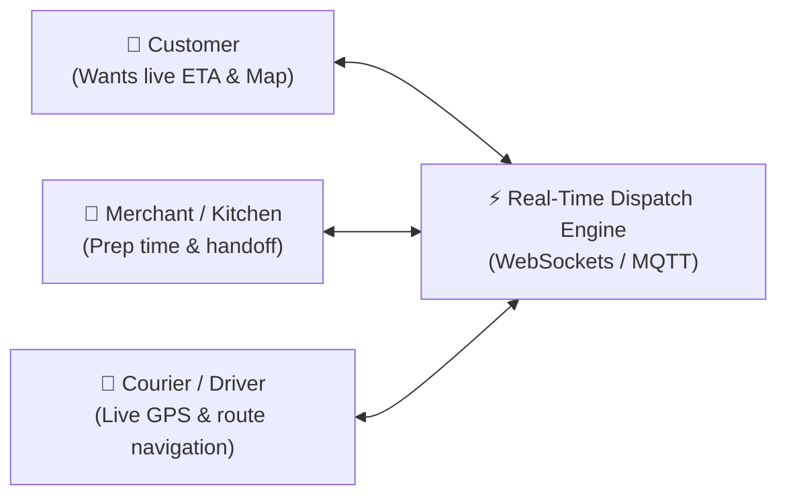
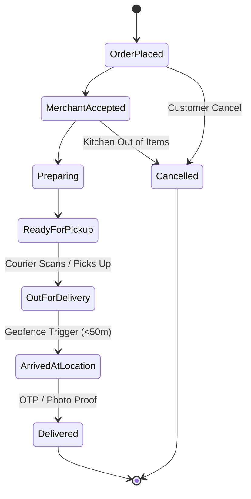
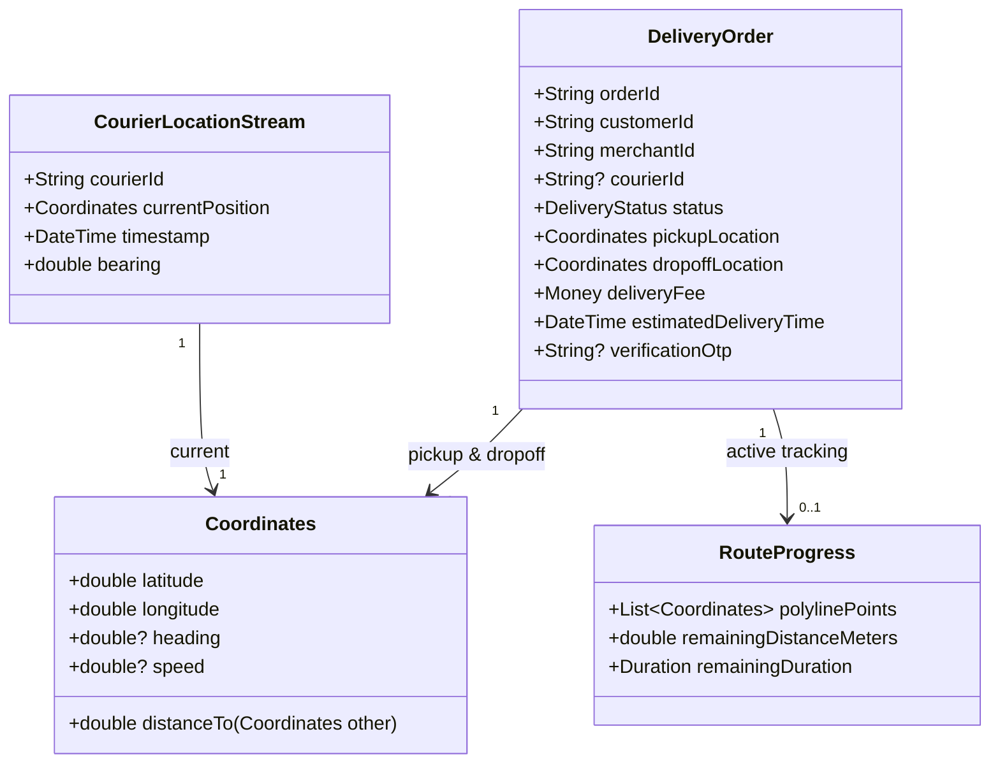

# Delivery App: Architecture & Mental Model Blueprint

> Senior Engineering Guide: How to design an on-demand delivery platform, manage real-time geospatial streams, orchestrate multi-actor state machines, and avoid battery and network traps.

---

## 1. The Senior Delivery Engineer's Mental Model

A delivery app (food delivery, grocery, or courier) is fundamentally a **real-time geospatial orchestration engine**.

| Dimension | Health Tracker | Finance App | E-Commerce App | On-Demand Delivery App |
| :--- | :--- | :--- | :--- | :--- |
| **Core Nature** | Biometric sampling | Immutable ledger | Inventory & checkout | **Real-time geospatial orchestration** |
| **Actors** | 1 (User) | 1 (User) | 2 (Buyer, Merchant) | **3 Actors (Customer, Merchant, Courier)** |
| **Data Flow** | Batch / Periodic sync | Atomic transactions | Request / Response (HTTP) | **Continuous Streams (WebSockets / MQTT / GPS)** |
| **Critical Failure** | Data loss / bad sensor | Rounding / phantom cents | Double charge / out-of-stock | **Ghost drivers / stale ETAs / dead-zone drops** |
| **AI Role** | Health habit insights | Spending anomaly detection | Semantic search & filters | **Dynamic ETA prediction & intelligent dispatch routing** |

---

## 2. Core Architectural Pillars of Delivery Systems

### 1. The 3-Sided Synchronization Problem
In an e-commerce app, only the buyer and store interact. In a delivery app, three independent parties must stay synchronized in real time:

- If the merchant takes 15 minutes longer, the courier's dispatch must be delayed to avoid cold food.
- If the courier enters a subway tunnel or dead zone, the customer's UI must not crash or show a "teleporting" driver.

### 2. Geospatial Value Objects & Battery Optimization
A junior developer treats GPS coordinates as loose primitives: `double lat, double lng`.
- **The Senior Way**: Wrap coordinates in a strongly-typed `Coordinates` value object that validates boundaries ($\text{lat} \in [-90, 90]$, $\text{lng} \in [-180, 180]$) and calculates distance using the Haversine formula.
- **Battery Rule**: Continuously firing high-accuracy GPS every second drains 30% battery per hour. A senior architecture uses **distance-filtered throttling** (e.g., only emit coordinate updates if the courier moved $\ge 10$ meters or every 10 seconds).

### 3. The Strict Fulfillment State Machine
A delivery cannot jump states arbitrarily. The domain layer must enforce strict valid transitions:

---

## 3. Domain Modeling: Entities & Value Objects

### Domain Invariants
1. **No Skip-Ahead**: An order cannot be marked `Delivered` unless it is currently `ArrivedAtLocation` and the verification OTP or signature is validated.
2. **Cancellation Freeze**: Once an order reaches `Preparing` or `OutForDelivery`, cancellation cannot be performed without cancellation penalty rules.
3. **Speed Invariant**: If a driver's coordinates jump 5 km in 2 seconds, the domain layer flags this as GPS spoofing or a bad telemetry sample and discards it.

---

## 4. The 4 Anti-Patterns to Avoid in Delivery Apps

### ❌ Anti-Pattern 1: Polling REST APIs Every 2 Seconds for Driver Location
- **The Mistake**: Running a `Timer.periodic` that hits `GET /driver-location` every 2 seconds.
- **Why it Fails**: If you have 10,000 active deliveries, that is 5,000 requests per second hitting your database. Battery drains instantly and the server throttles the client.
- **Senior Solution**: Use a bidirectional persistent connection (**WebSocket** or **MQTT**) where the server pushes location updates only when the driver moves.

### ❌ Anti-Pattern 2: Teleporting Car Marker on the Map
- **The Mistake**: Directly assigning the new GPS coordinate to the map marker position whenever a packet arrives.
- **Why it Fails**: The marker jerks abruptly and points in random directions due to GPS noise.
- **Senior Solution**: Interpolate marker movement using a tween animation (`AnimationController` or spherical linear interpolation) and calculate the bearing (rotation angle) between consecutive coordinates.

### ❌ Anti-Pattern 3: Losing Delivery Actions in Cellular Dead Zones
- **The Mistake**: The courier taps "Confirm Pickup" in an elevator with zero reception, the HTTP request fails, and the app resets to "Awaiting Pickup".
- **Why it Fails**: The courier is now driving without a route on their screen.
- **Senior Solution**: Offline-first command queue. The pickup action is committed to an encrypted local Hive queue, the UI updates optimistically, and a background sync worker retries the upload as soon as connectivity resumes.

### ❌ Anti-Pattern 4: Unconstrained LLMs for Real-Time Dispatch & Routing
- **The Mistake**: Asking an LLM to generate turn-by-turn road routes.
- **Why it Fails**: LLMs do not have live road topologies, traffic light cycles, or road closure data. They hallucinate non-existent roads.
- **Senior Solution**: Use dedicated routing engines (OSRM, Google Directions, Mapbox) for the coordinates. Use Gemini for **contextual intelligence**: predicting kitchen preparation delays based on order volume and weather, or drafting automated customer update messages.
