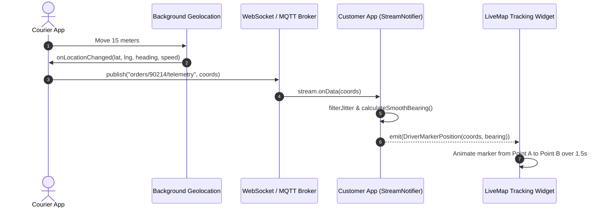
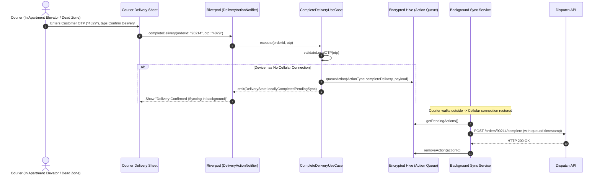
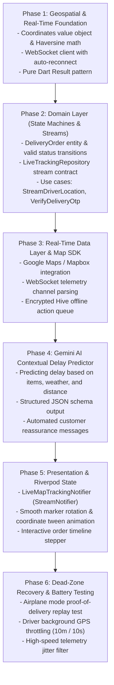

# Delivery App: Production Implementation Roadmap

> Tailored for: **Clean Architecture** + **Riverpod** + **WebSocket / MQTT Live Streams** + **Offline Hive Queue** + **Gemini AI Predictive ETA**.

---

## 1. System Architecture & Real-Time Flows

### Flow 1: Live Driver Telemetry & Map Marker Interpolation



### Flow 2: Offline-First Proof of Delivery in a Cellular Dead Zone



---

## 2. Modular Folder Structure for Delivery App

```
lib/
├── app/
│   ├── app.dart                   # MaterialApp, Theme, Global Lifecycle
│   └── router.dart                # Deep links (e.g., track/order/:id)
├── core/
│   ├── errors/
│   │   ├── exceptions.dart        # SocketException, GeolocationException
│   │   └── failures.dart          # Result<S, F> sealed classes
│   ├── geospatial/
│   │   ├── coordinates.dart       # Coordinates Value Object (lat, lng, bearing)
│   │   ├── haversine.dart         # Pure Dart distance & proximity calculator
│   │   └── polyline_decoder.dart  # Decode route polylines into LatLng lists
│   ├── network/
│   │   ├── websocket_client.dart  # Resilient WebSocket connection with heartbeat
│   │   └── offline_queue.dart     # Action replay manager for dead zones
│   └── utils/
│       └── marker_interpolator.dart# Spherical linear interpolation (Slerp)
├── features/
│   ├── order_fulfillment/         # Lifecycle state machine
│   │   ├── domain/
│   │   │   ├── entities/          # DeliveryOrder, OrderStatus, DeliveryParty
│   │   │   ├── repositories/      # DeliveryOrderRepository (interface)
│   │   │   └── usecases/          # GetActiveOrderUseCase, UpdateOrderStatusUseCase
│   │   ├── data/
│   │   │   ├── models/            # DeliveryOrderHiveModel, DTO Mappers
│   │   │   └── repositories/      # DeliveryOrderRepositoryImpl (Hive + REST)
│   │   └── presentation/
│   │       ├── controllers/       # OrderLifecycleNotifier
│   │       ├── widgets/           # OrderTimelineStepper, OtpVerificationDialog
│   │       └── views/             # ActiveOrderDashboardScreen
│   ├── live_tracking/             # Real-time GPS & Map
│   │   ├── domain/
│   │   │   ├── entities/          # TelemetrySample, RouteLeg, ETAEstimate
│   │   │   ├── repositories/      # LiveTrackingRepository (Stream interface)
│   │   │   └── usecases/          # StreamDriverPositionUseCase, CalculateEtaUseCase
│   │   ├── data/
│   │   │   ├── datasources/       # WebSocketTelemetryDataSource, GoogleDirectionsApi
│   │   │   └── repositories/      # LiveTrackingRepositoryImpl
│   │   └── presentation/
│   │       ├── controllers/       # LiveMapTrackingNotifier (StreamNotifier)
│   │       ├── widgets/           # GoogleMap/MapboxWidget, DriverInfoCard
│   │       └── views/             # LiveTrackingMapScreen
│   └── ai_dispatch_eta/           # Gemini AI Contextual Delay Engine
│       ├── domain/
│       │   ├── entities/          # PredictiveEta, DelayRiskFactor
│       │   └── usecases/          # PredictKitchenDelayUseCase
│       ├── data/
│       │   └── datasources/       # GeminiEtaPredictorDataSource
│       └── presentation/
│           └── widgets/           # SmartEtaBadge, DelayExplanationCard
└── main.dart
```

---

## 3. The 6-Phase Engineering Roadmap



---

## 4. Phase-by-Phase Checklist & Deliverables

### Phase 1: Geospatial & Real-Time Infrastructure
- [ ] Implement `Coordinates` value object with range assertions ($\text{lat} \in [-90, 90]$, $\text{lng} \in [-180, 180]$).
- [ ] Write pure Dart Haversine formula to compute meters between two points.
- [ ] Implement `WebSocketClient` with ping/pong keepalive, exponential backoff reconnect, and connection state streams.

### Phase 2: Domain Layer (Zero Dependencies)
- [ ] Define `DeliveryOrder` and `OrderStatus` sealed class hierarchy:
  - `OrderPlaced`, `MerchantAccepted`, `Preparing`, `ReadyForPickup`, `OutForDelivery`, `Arrived`, `Delivered`, `Cancelled`.
- [ ] Implement state machine guards (e.g. `cannot transition to Delivered without valid OTP`).
- [ ] Define abstract `LiveTrackingRepository` returning `Stream<Coordinates>`.

### Phase 3: Real-Time Data & Offline Queue
- [ ] Configure `google_maps_flutter` or `mapbox_maps_flutter`.
- [ ] Implement `LiveTrackingRepositoryImpl` mapping incoming WebSocket JSON payloads to `Coordinates`.
- [ ] Implement `OfflineActionQueueService` in Hive to store pending status updates during dead zones.

### Phase 4: Gemini AI Contextual Delay Predictor
- [ ] Formulate prompt with structured JSON output schema:
  - Input: Restaurant busy score, items count (e.g., 8 large pizzas), precipitation, traffic multiplier.
  - Output: `{ "estimatedPrepMinutes": 22, "delayRisk": "HIGH", "customerNotice": "..." }`
- [ ] Enforce fallback to static distance/speed calculation if AI request times out.

### Phase 5: Presentation Layer (Riverpod)
- [ ] Implement `LiveTrackingNotifier` using `StreamNotifier<LiveTrackingState>`:
  - Calculate bearing (angle in degrees) between coordinate $N-1$ and coordinate $N$.
  - Animate custom vehicle icon along the polyline.
- [ ] Build `DeliveryProgressBottomSheet` with dynamic ETA countdown and call driver button.

### Phase 6: Edge Cases & Field Testing
- [ ] Test the **Tunnel Scenario**: disconnect internet while tracking; verify UI shows "Reconnecting..." and retains the driver's last known position without clearing the map.
- [ ] Test the **Elevator Scenario**: driver submits OTP offline; verify Hive queues it and auto-completes when network returns.
- [ ] Verify battery consumption of the driver app background tracking service.
