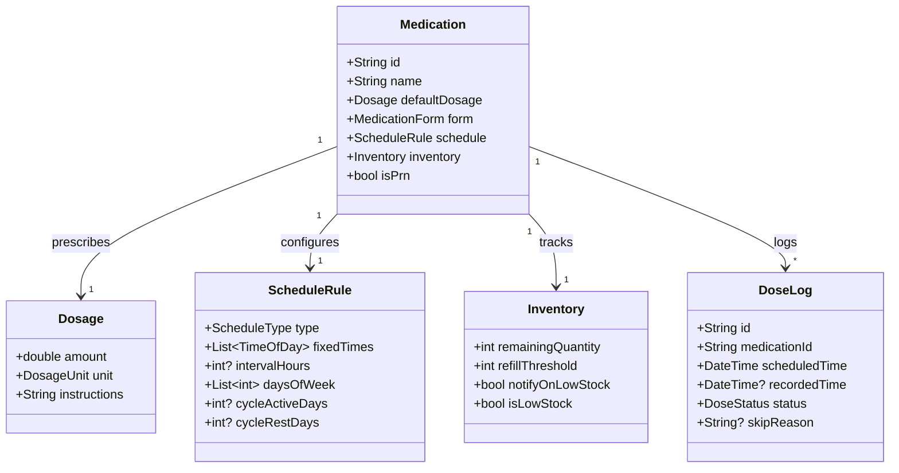

# Medicine Tracker: Architecture & Mental Model Blueprint

> Senior Engineering Guide: How to design a life-critical medication adherence system, master exact OS alarm scheduling, build complex recurrence engines, and avoid notification drop traps.

---

## 1. The Senior Medicine Tracker Engineer's Mental Model

A medicine tracker is **not** a generic to-do list app. If a user misses a reminder to buy groceries, it is an inconvenience. If a transplant patient or diabetic misses an immunosuppressant or insulin dose, it is a **medical emergency**.

| Dimension | E-Commerce | Delivery App | Medicine Tracker App |
| :--- | :--- | :--- | :--- |
| **Core Nature** | Inventory & checkout | Real-time geospatial streams | **Life-critical temporal scheduling & adherence** |
| **Tolerance for Missed Reminders** | High (Push notification can wait) | Medium (Driver can look at screen) | **ZERO (Notification MUST fire even in Doze mode)** |
| **Primary Invariant** | Stock $\ge$ 0, valid price | State machine order transitions | **PRN safety limits & exact dose logging** |
| **Data Authority** | Server-authoritative | 3-Sided Real-Time Dispatch | **Local-authoritative with offline resilience** |
| **AI Role** | Search filters & styling | Dynamic ETA & delay prediction | **Prescription label OCR & drug interaction warnings** |

---

## 2. Core Architectural Pillars of Medication Systems

### 1. The Exact Alarm vs. Push Notification Problem
A junior developer sets up a standard background timer or basic push notification.
- **The Fatal Flaw**: Both Android (Doze Mode) and iOS (Background App Refresh / Low Power Mode) will delay or suppress standard timers to save battery. Reminders can be delayed by 45 minutes or never ring.
- **The Senior Architecture**: 
  - On Android: Request `android.permission.SCHEDULE_EXACT_ALARM` or `USE_EXACT_ALARM` and wake the device using `AlarmManager.setAlarmClock()`.
  - On iOS: Use local notifications configured with sound and critical alerts, or background VoIP/Alarm pushes.
  - Implement a `BOOT_COMPLETED` receiver: when the user's phone restarts, all scheduled alarms are wiped by the OS and must be immediately reconstructed from your encrypted Hive database.

### 2. Complex Recurrence & Schedule Modeling
Medication schedules are notoriously diverse:
1. **Fixed Times Daily**: E.g. 8:00 AM and 8:00 PM with food.
2. **Interval (Around-the-Clock)**: Every 6 hours (8:00 AM, 2:00 PM, 8:00 PM, 2:00 AM).
3. **Cyclical Regimens**: E.g. Birth control (21 days active pills, 7 days placebo/off).
4. **Tapering Dosages**: Prednisone (40mg for 3 days, 30mg for 3 days, 20mg for 3 days).
5. **PRN / As-Needed**: Painkillers taken on demand, but with strict safety bounds (*"Take 1 pill when needed, but at least 4 hours apart, maximum 4 pills in 24 hours"*).

### 3. The Immutable Adherence Ledger
Do not store dose tracking as a simple boolean `isTaken = true` on the `Medication` object.
- **The Senior Way**: Every single intake is an immutable event in a `DoseLog` ledger:
  - `scheduledFor`: Timestamp
  - `recordedAt`: Actual timestamp taken
  - `status`: `Taken`, `Skipped` (with reason: e.g. nausea), `Missed` (time window expired), `Snoozed`.
  - This allows generating clinical adherence reports (% compliance) for physicians.

---

## 3. Domain Modeling: Entities & Value Objects

### Domain Invariants
1. **No Future Intake**: A `DoseLog` cannot have a `recordedTime` set in the future.
2. **PRN Lockout Invariant**: For an As-Needed drug, a new dose cannot be recorded if `(now - lastTakenTime) < minHoursBetweenDoses`.
3. **Inventory Non-Negativity**: Recording a taken dose decrements `Inventory.remainingQuantity`. If quantity would drop below zero, the domain flags an inventory discrepancy warning.
4. **Dosage Integrity**: Dosage amount must be $> 0$ and must have a concrete unit (`mg`, `ml`, `tablets`, `drops`, `units`).

---

## 4. The 4 Anti-Patterns to Avoid in Medicine Apps

### ❌ Anti-Pattern 1: Wiping Alarms on Phone Reboot
- **The Mistake**: Scheduling notifications only in memory or relying on the OS to keep them forever.
- **Why it Fails**: When an Android or iOS device restarts, all pending alarms in the OS alarm manager are deleted. The user stops receiving medicine alerts.
- **Senior Solution**: Listen to `RECEIVE_BOOT_COMPLETED` on native Android and re-calculate/re-register all active medication schedules from the Hive database.

### ❌ Anti-Pattern 2: Ignoring Timezone Shifts & Daylight Saving
- **The Mistake**: Storing scheduled times as static UTC timestamps (`2026-11-03 08:00:00Z`).
- **Why it Fails**: If the user flies from New York to London or DST occurs, their 8:00 AM morning blood pressure medication suddenly alarms at 1:00 PM.
- **Senior Solution**: Store scheduled alarm times as **Wall-Clock Time** (`TimeOfDay(hour: 8, minute: 0)`) relative to the local device timezone, calculating next trigger instances dynamically.

### ❌ Anti-Pattern 3: Unbounded "As-Needed" (PRN) Logging
- **The Mistake**: Allowing users to tap "Log Dose" as many times as they want without cooldown checks.
- **Why it Fails**: Overdose risk for high-potency analgesics or sedatives.
- **Senior Solution**: Domain invariant: query the last 24 hours of `DoseLog` entries for that medication. If dose count $\ge \text{maxDailyLimit}$, disable the button and show a clinical safety alert.

### ❌ Anti-Pattern 4: Using AI to Replace Pharmacist Review
- **The Mistake**: Letting an LLM output *"This drug combination is 100% safe to take."*
- **Why it Fails**: Extreme medical liability and risk of fatal interaction omissions.
- **Senior Solution**: Use Gemini for **Prescription OCR** (reading label photos into structured text) and **Informational Interaction Flagging** (flagging known contraindications for doctor discussion, accompanied by mandatory legal disclaimers).
