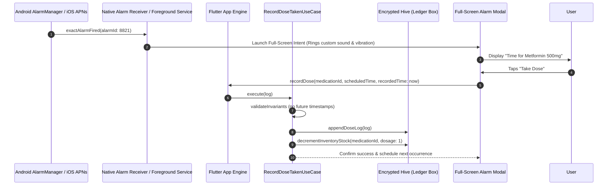
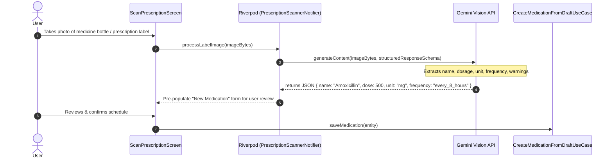
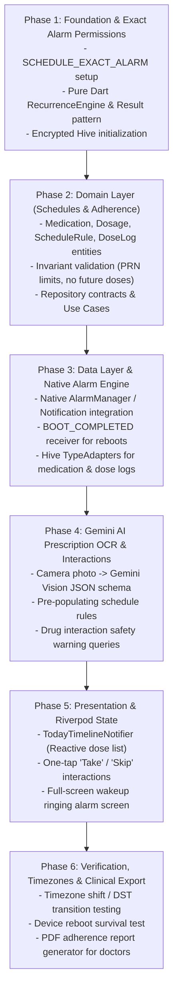

# Medicine Tracker: Production Implementation Roadmap

> Tailored for: **Clean Architecture** + **Riverpod** + **Native Exact Alarms** + **Encrypted Hive** + **Gemini AI Prescription Scanner**.

---

## 1. System Architecture & Core Flows

### Flow 1: Exact Alarm Trigger & Adherence Logging (Even in Doze Mode)



### Flow 2: AI Prescription Label Scanner (Vision OCR)



---

## 2. Modular Folder Structure for Medicine Tracker

```
lib/
├── app/
│   ├── app.dart                   # MaterialApp, Theme (High-contrast medical theme)
│   └── router.dart                # Deep links (alarm-action/:medicationId)
├── core/
│   ├── alarms/
│   │   ├── alarm_scheduler.dart   # Bridge to OS AlarmManager (Exact alarms)
│   │   ├── boot_receiver.dart     # Auto-reschedules alarms on device reboot
│   │   └── notification_channels.dart # Critical medical alert sound channels
│   ├── errors/
│   │   ├── exceptions.dart        # AlarmSchedulingException, StorageException
│   │   └── failures.dart          # Result<S, F> sealed classes
│   └── utils/
│       ├── recurrence_engine.dart # Pure Dart next-dose calculator
│       └── timezone_handler.dart  # Wall-clock to local timezone converter
├── features/
│   ├── medications/               # Medication definitions & inventory
│   │   ├── domain/
│   │   │   ├── entities/          # Medication, Dosage, ScheduleRule, Inventory
│   │   │   ├── repositories/      # MedicationRepository (interface)
│   │   │   └── usecases/          # AddMedication, UpdateInventoryStock
│   │   ├── data/
│   │   │   ├── models/            # MedicationHiveModel, DosageHiveModel
│   │   │   └── repositories/      # MedicationRepositoryImpl
│   │   └── presentation/
│   │       ├── controllers/       # MedicationListNotifier
│   │       └── views/             # MedicationDetailScreen, AddMedicationScreen
│   ├── adherence/                 # Daily Timeline & Pill Logging
│   │   ├── domain/
│   │   │   ├── entities/          # DoseLog, DoseStatus (Taken/Skipped/Missed)
│   │   │   ├── repositories/      # AdherenceRepository (interface)
│   │   │   └── usecases/          # RecordDoseActionUseCase, GetDailyTimelineUseCase
│   │   ├── data/
│   │   │   ├── models/            # DoseLogHiveModel
│   │   │   └── repositories/      # AdherenceRepositoryImpl
│   │   └── presentation/
│   │       ├── controllers/       # TodayTimelineNotifier (AsyncNotifier)
│   │       ├── widgets/           # PillDoseCard, QuickActionButtons, RefillBadge
│   │       └── views/             # TodayScheduleScreen, AdherenceReportScreen
│   └── ai_prescription_scanner/   # Gemini OCR & Interaction Checks
│       ├── domain/
│       │   ├── entities/          # ScannedMedicationDraft, DrugInteractionWarning
│       │   └── usecases/          # ScanLabelImageUseCase, CheckDrugInteractionsUseCase
│       ├── data/
│       │   └── datasources/       # GeminiPrescriptionVisionDataSource
│       └── presentation/
│           ├── controllers/       # ScannerNotifier
│           └── views/             # CameraScannerScreen, ReviewExtractedDataScreen
└── main.dart
```

---

## 3. The 6-Phase Engineering Roadmap



---

## 4. Phase-by-Phase Checklist & Deliverables

### Phase 1: Core Foundation & Alarm System Setup
- [ ] Add `android.permission.SCHEDULE_EXACT_ALARM`, `USE_EXACT_ALARM`, and `WAKE_LOCK` to Android manifest.
- [ ] Configure `flutter_local_notifications` and the native `alarm` package for lockscreen wakeups.
- [ ] Write pure Dart `RecurrenceEngine` (calculating next trigger dates for daily, interval, cyclical, and PRN schedules).

### Phase 2: Domain Layer (Zero Dependencies)
- [ ] Implement `Dosage` value object (`amount`, `unit`, `instructions`).
- [ ] Implement `ScheduleRule` supporting fixed times, intervals, day-of-week filters, and cycles.
- [ ] Implement `DoseLog` entity with status enum: `Scheduled`, `Taken`, `Skipped`, `Missed`, `Snoozed`.
- [ ] Write use case tests ensuring PRN drugs reject doses taken too close together.

### Phase 3: Data Layer & Native Boot Resilience
- [ ] Implement `EncryptedMedicationBox` and `EncryptedDoseLogBox` in Hive.
- [ ] Wire native Android `BroadcastReceiver` for `BOOT_COMPLETED` to reschedule alarms whenever the phone reboots.
- [ ] Implement `AlarmSchedulerService` to synchronize upcoming schedule occurrences with native OS alarms.

### Phase 4: Gemini AI Vision Prescription Scanner
- [ ] Build camera capture flow using `image_picker` or `camera`.
- [ ] Configure Gemini Vision prompt with strict JSON schema:
  - Extract: `medicationName`, `strengthNumber`, `strengthUnit`, `frequencyDescription`, `suggestedTimes`.
- [ ] Create `CheckDrugInteractionsUseCase` that compares newly added medications against existing active medications and returns flagged contraindications.

### Phase 5: Presentation Layer (Riverpod)
- [ ] Build `TodayTimelineNotifier`:
  - Groups doses into Morning, Afternoon, Evening, Bedtime buckets.
  - Reactive updating when a pill is marked taken.
- [ ] Build `FullScreenAlarmView` displaying high-contrast buttons for elderly/impaired vision accessibility.
- [ ] Implement inventory low-stock alert pill card (`"Only 4 tablets remaining"`).

### Phase 6: Edge Cases & Reliability Verification
- [ ] **The Reboot Test**: schedule an alarm 3 minutes in the future, reboot the device, and verify the alarm still fires.
- [ ] **The Timezone Test**: change the phone's clock or timezone; verify scheduled doses stay fixed to local wall-clock time.
- [ ] **The Zero-Dose Edge Case**: verify inventory correctly transitions to "Empty" without crashing or allowing negative integers.
